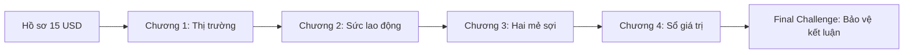

# Kế hoạch remaster gameplay Surplus Lab

> Bản kế hoạch để triển khai, chưa phải danh sách tính năng đã hoàn thành. Căn cứ: `IDEA.md`, `TRICH_XUAT_GIAO_TRINH_CHUONG_3.md`, `HOP_DONG_MODULE.md`, `PHAN_CONG_9_THANH_VIEN.md` và code hiện tại. Phạm vi là hành trình chính từ Landing đến Final Challenge; Sandbox chỉ ở giai đoạn mở rộng sau khi hành trình chính ổn định.

## 1. Chẩn đoán đúng trạng thái hiện tại

| Điểm trong hành trình | Đang có trong repo | Khoảng trống trải nghiệm |
| --- | --- | --- |
| Landing `/` | Giới thiệu và các link chương trong `app/page.tsx` | Chưa có bản đồ nhiệm vụ, hồ sơ vụ án, trạng thái mở khóa/hoàn thành và lời dẫn nhập chung. |
| Chương 1 `/learn/chapter-1` | `ChapterShell` dạng màn chờ; `features/market` mới có type | Chưa có 100 bot, trao đổi, điều khiển, biểu đồ và lập luận về lưu thông. |
| Chương 2 `/learn/chapter-2` | Chọn một trong ba nhân vật; xem hai điều kiện và hai thuộc tính | Người chơi chọn đáp án trước khi thu thập bằng chứng; ba bộ phận giá trị sức lao động chủ yếu là văn bản. |
| Chương 3 `/learn/chapter-3` | Chọn đầu vào, chọn ba công đoạn, đồng hồ tự chạy, điều tra 2 giờ, hỏi 4 giờ, tính 6 giờ, kết quả 8 giờ | Ba công đoạn mới là các nút theo thứ tự; bông, xơ, máy và bàn tay công nhân chưa tạo thành một quá trình có nguyên nhân và kết quả đủ rõ. Có nhiều điểm dừng hỏi đáp, ít quyết định trong lúc sản xuất. |
| Chương 4 `/learn/chapter-4` | Lý thuyết, kéo thả c/v/m, kiểm toán ba nhận định, kết quả | Vẫn là phân loại đáp án có sẵn; người chơi chưa tự xây dựng sổ cái từ hai mẻ sợi đã sản xuất. |
| Final Challenge `/challenge` | Màn chờ | Chưa có 10 câu thật, chấm điểm, giải thích, tái thử theo lỗi hay kết quả cuối hành trình. |
| Tiến độ chung | Chương 2–4 phát sự kiện hoàn thành | Chưa có nơi nhận sự kiện; HUD đang cố định “121 USD” và “HUY HIỆU 02”, không phản ánh hành trình. |

Kết luận thiết kế: thêm nhiều câu hỏi trắc nghiệm sẽ không giải quyết cảm giác đơn giản. Cần để mỗi thao tác của người chơi thay đổi **vật thể, trạng thái nhà máy và sổ giá trị**; câu hỏi xuất hiện tại thời điểm cần ra quyết định.

## 2. Khung kiến thức không được làm sai

| Luận điểm từ bản trích | Cách chuyển thành gameplay | Điều phải tránh |
| --- | --- | --- |
| H–T–H hướng tới giá trị sử dụng; T–H–T' hướng tới giá trị lớn hơn | Hai tuyến giao dịch cùng xuất hiện ở chương 1; người chơi so sánh mục tiêu và dòng tài sản | Không cho rằng đổi chác thông thường tự tạo giá trị mới cho toàn xã hội. |
| Giá bán cao hơn giá trị có thể làm một bên được lợi, bên kia thiệt | Cho inspect hai bot trước/sau giao dịch, đồng thời xem tổng tiền/hàng của thị trường đóng | Không đồng nhất lợi ích cá nhân hay tăng giá bán với giá trị thặng dư được sản xuất. |
| Sức lao động thành hàng hóa khi **đồng thời** tự do về thân thể và thiếu tư liệu sản xuất cần thiết | Người chơi tìm chứng cứ cho từng nhân vật rồi mới kết luận | Không xem “thiếu tư liệu” là điều kiện duy nhất; không dùng chuyện đời sống người lao động làm trò đùa. |
| Giá trị sức lao động gồm tư liệu sinh hoạt, đào tạo, nuôi dưỡng thế hệ sau; giá trị sử dụng thể hiện khi lao động | Hồ sơ ba nhu cầu và hợp đồng 8 giờ; so sánh 15 USD giá trị sức lao động với 30 USD giá trị mới | Không gán tỉ lệ USD cho từng nhu cầu nếu giáo trình không nêu; không nhầm sức lao động với chính quá trình lao động. |
| Lao động cụ thể biến bông thành sợi và chuyển giá trị cũ; lao động trừu tượng tạo giá trị mới | Hai dòng màu/nhãn chạy song song trong cùng một cảnh công nhân thao tác | Không vẽ máy tự tạo `m`; không cộng giá trị bông/máy như giá trị mới. |
| Mẻ 1, 4 giờ: bông 50 + hao mòn 3 + giá trị mới 15 = sợi 68, `m = 0` | Người chơi làm mẻ đầu, dự đoán rồi mở sổ cái 4 giờ | Không hiển thị sớm đáp án trong nút, màu hoặc lời dẫn. |
| Mẻ 2, 4 giờ tiếp: thêm bông 50 + hao mòn 3; **không trả thêm 15 USD** cho cùng hợp đồng 8 giờ | Người chơi lập phiếu cấp vật tư cho mẻ 2 và phát hiện mục “tiền sức lao động lần hai” là sai trong ví dụ | Không dùng cơ chế này để cổ vũ một quan hệ lao động thực tế; trình bày đây là phép tính trong ví dụ giáo trình. |
| Cả ca: ứng 121, `c = 106`, `v = 15`, giá trị mới 30, `m = 15`, `G = 136` | Sổ cái và cuộn sợi cuối ca ghép từ các thẻ 100/6/15/15 | Không nhầm vốn ứng trước 121 với giá trị sợi đã làm ra ở giờ 0/4/6. |

Giờ 2 và 6 là điểm **nội suy với giả định tốc độ đều**. Màn học bắt buộc dùng mốc giáo trình 0/4/8; thử thách giờ 2/6 nên là nhánh đào sâu có nhãn giả định, không phải căn cứ duy nhất để qua chương. Frame Figma giờ 6 ghép `c` của cả ca để minh họa `128,5 USD`; sản lượng đã tạo đến giờ 6 theo engine là `102 USD`. Hai nhãn phải được tách hẳn.

## 3. Trải nghiệm mục tiêu: “Đi tìm 15 USD”

Người chơi vào vai người điều tra quá trình sản xuất. Câu hỏi xuyên suốt: **121 USD ứng trước biến thành 136 USD giá trị sợi ở đâu?** Họ nhận bốn mảnh chứng cứ qua bốn chương: `lưu thông`, `sức lao động`, `hai mẻ sản xuất`, `cấu tạo giá trị`. Mảnh chứng cứ là tiến độ học, không phải USD hay một phần của công thức kinh tế.

Vòng chơi áp dụng ở mọi chương:

1. **Quan sát hiện trường:** xem vật thể/nhân vật/số liệu trước khi có câu trả lời.
2. **Đưa giả thuyết:** chọn hoặc sắp xếp một dự đoán có ý nghĩa.
3. **Thao tác và xem hệ quả:** giao dịch, mở hồ sơ, đưa bông qua máy, lập phiếu vật tư, ghép sổ cái.
4. **Đối chiếu chứng cứ:** animation chỉ chạy sau hành động và chỉ ra giá trị chuyển đi, tạo mới hoặc được phân phối lại.
5. **Giải thích ngắn, thử lại:** phản hồi chỉ đúng chỗ nhầm; lần thử sau giữ những phần đã làm đúng.
6. **Đưa chứng cứ vào nhật ký:** một câu kết luận và một sơ đồ nhỏ được mang sang chương kế tiếp.

Nhịp đề xuất: toàn hành trình 25–35 phút; bản demo có nút bỏ qua hoạt họa đã xem để đi trong 7–10 phút. Không đặt đồng hồ đếm ngược cho bài suy luận. Người chơi có thể dừng, xem lại và tua animation; âm thanh chỉ bắt đầu khi họ bật.

## 4. Thiết kế theo từng màn

### 4.1 Landing và Campaign Map — M1, M8

- Mở bằng hợp đồng 8 giờ, hình cuộn sợi khóa và hai con số `121` / `136`, đặt câu hỏi “15 USD xuất hiện từ đâu?” nhưng chưa trả lời. Tạo bản đồ nhà máy/thị trường bốn trạm; mỗi trạm có mục tiêu, thời lượng ước tính và một hình chứng cứ thu được.
- Khi hoàn thành trạm, chứng cứ bay vào sổ điều tra, bản đồ đổi trạng thái và lời dẫn nối sang trạm tiếp theo. HUD hiển thị chương, tiến độ thực, chứng cứ; không giữ số huy hiệu hoặc số vốn cố định ở mọi trang.
- Cho phát lại chương đã hoàn thành. Direct link vào chương phải có trạng thái rõ ràng; không đẩy người chơi vào màn trắng vì thiếu tiến độ trong phiên. Hoàn thành một chương là sự kiện có dữ liệu, không chỉ một hiệu ứng.
- Điều kiện qua màn: người chơi hiểu mục tiêu của chương kế tiếp và biết mình đang đi tìm nguồn của khoản chênh lệch, không bị spoil kết luận.

### 4.2 Chương 1: phòng giao dịch 100 bot — M2 + M3

- **Tình huống A, đổi để dùng:** người chơi chọn hàng để mua sau khi bán hàng của mình. Dòng H–T–H hiện bằng hai thẻ hàng và tiền ở giữa; cảnh kết thúc bằng hàng để tiêu dùng. Một bot có thể được inspect để nhìn tiền và kho trước/sau.
- **Tình huống B, mua bán kiếm lời:** cho chọn mức giá trên/dưới giá trị tham chiếu. Một giao dịch có người lời và người thiệt; trên bản đồ 100 bot, tiền/hàng di chuyển giữa các chủ thể. Khi nhấn “toàn thị trường”, tổng tiền, từng loại hàng và giá trị tham chiếu không đổi.
- **Thử thách dự đoán:** trước khi chạy mỗi vòng, người chơi chọn điều họ nghĩ sẽ tăng: tài sản của bot A, tổng tiền thị trường, hoặc tổng giá trị tham chiếu. Sau giao dịch, đối chiếu dự đoán với ledger trước/sau; giải thích vì sao lợi ích một bên không đồng nghĩa giá trị mới toàn xã hội.
- **Tương tác có chủ đích:** chọn một bot, tua nhanh 10/50/100 lượt, đổi xác suất và biên giá trong giới hạn an toàn, tạm dừng để xem một giao dịch cụ thể. Mỗi lượt animation dùng đường đi của tiền/hàng; biểu đồ chỉ vẽ lại khi số liệu đổi. Seed cố định cho “chơi lại cùng kịch bản”.
- **Đầu ra học tập:** người chơi tự gắn kết luận “lưu thông chưa giải thích nguồn 15 USD” vào hồ sơ; từ đó mở chương sức lao động. Không gọi chênh lệch giá bán của một bot là `m`.

### 4.3 Chương 2: hồ sơ sức lao động — M6

- Thay thao tác “nhìn mô tả và chọn ngay người đúng” bằng **ba hồ sơ điều tra**. Mỗi hồ sơ có hai chứng cứ có thể mở: quyền tự quyết việc làm và tình trạng tư liệu sản xuất. Người chơi đánh dấu đạt/chưa đạt cho từng điều kiện rồi kết luận; nếu sai, chỉ chiếu sáng chứng cứ mâu thuẫn, không tô sẵn đáp án toàn màn.
- Mỗi nhân vật có chân dung, bối cảnh và hoạt động riêng; chuyển động nhỏ thể hiện họ làm việc/sản xuất. Trình bày nhân vật tôn trọng, không coi tình trạng thiếu tư liệu là điểm để châm biếm.
- Sau khi xác định đúng, người chơi mở **hồ sơ giá trị sức lao động**: kéo ba nhóm nhu cầu (sinh hoạt, đào tạo, nuôi con) vào một hồ sơ định tính. Số `15 USD` là giá trị sức lao động của ví dụ, không chia ba tùy ý.
- Đặt cạnh hồ sơ **hợp đồng 8 giờ**: người chơi dự đoán giá trị sử dụng của sức lao động sẽ được nhìn thấy ở đâu, rồi chuyển sang nhà máy. Animation xe chở vật tư và công nhân nối trực tiếp hai chương; có nút bỏ qua.
- Điều kiện qua màn: giải thích được hai điều kiện cùng cần, và phân biệt giá trị sức lao động 15 với giá trị mới do quá trình lao động tạo ra.

### 4.4 Chương 3: nhà máy thật sự có hai mẻ — M4 + M5

Đây là trung tâm trải nghiệm. Chuyển từ một đồng hồ 8 giờ tự chạy thành **hai đơn hàng 50 kg bông, mỗi đơn 4 giờ**. Đồng hồ chỉ tiến sau khi vật tư và công đoạn của mẻ hợp lệ; giữa các hành động có animation ngắn rồi người chơi quyết định tiếp. Không bắt người chơi nhấn lặp ba nút y hệt cho cả ca.

| Thời điểm | Việc người chơi làm | Thay đổi nhìn thấy | Kiến thức được kiểm tra |
| --- | --- | --- | --- |
| 0 giờ | Lập phiếu cho mẻ 1: 50 USD bông, 3 USD hao mòn máy, hợp đồng sức lao động 15 USD cho 8 giờ; loại thẻ sợi/m có sẵn | Xe đẩy vật tư tới máy, sổ ứng trước ghi rõ từng khoản | Đầu vào khác kết quả; hợp đồng được mua cho cả ca |
| Mẻ 1 bắt đầu | Đưa bông vào bộ tách, nối dải xơ vào cặp con lăn, nhờ công nhân xử lý sợi ở trạm cuối | Bông tách thành nhiều dải xơ; con lăn chỉ quay khi có xơ; tay công nhân giữ sợi, cuộn nhận sợi dần | Quá trình vật chất cần cả tư liệu và lao động |
| Trong 0–4 giờ | Chạm vào hai dòng “giá trị cũ” và “giá trị mới” để kiểm tra nguồn, dự đoán m có tăng chưa | Dòng màu của bông/máy chảy vào sợi; dòng của lao động tăng bên cạnh; nhãn số hiện theo snapshot | Lao động cụ thể chuyển c; lao động trừu tượng tạo giá trị mới |
| Mốc 4 giờ | Điền ô trống `50 + 3 + ? = 68`, rồi chọn `m` đã xuất hiện chưa; chỉ sau đó mở lời giải | Nhà máy dừng, xưởng tối nhẹ, sổ cái 4 giờ hiện trong một khung rõ | `15` mới bù `v = 15`, `m = 0`; sản phẩm đã làm ra trị giá 68 |
| Chuẩn bị mẻ 2 | Chọn thêm 50 USD bông và 3 USD hao mòn; kiểm tra đề xuất “trả thêm 15 USD cho cùng hợp đồng 8 giờ” | Phiếu vật tư có dấu xác nhận; công nhân và máy tiếp tục cùng ca, không nhân đôi dòng v | Cả ca ứng 121, không đếm v hai lần |
| Trong 4–8 giờ | Dự đoán phần giá trị mới nào vượt v; quan sát cuộn sợi thứ hai và so sánh với cuộn đầu | Bộ đếm v dừng ở 15; m xuất hiện và tăng có giải thích; sợi vẫn được làm ra | Lao động thặng dư tạo phần giá trị mới dôi ra |
| 8 giờ | Mở sổ cuối ca, tự ghép 100/6/15/15 rồi xác nhận | Hai mẻ nhập một bảng: `G = 136`, ứng trước `121`, `m = 15` | Phân biệt giá trị hàng hóa với vốn ứng trước và nguồn m |

Điều tra giờ 2 và bài tính giờ 6 hiện có chuyển thành **trạm đào sâu tùy chọn** sau khi người chơi hiểu mốc 4/8. Chúng không cắt ngang animation chính. Nếu bật giờ 6, hiển thị rõ giả định tốc độ đều và `G` đã sản xuất là `102 USD`, không dùng số minh họa cả ca `128,5 USD` làm sản lượng thực tế.

**Cảnh vận hành cần dựng:** một camera ngang liên tục với kho bông → bộ mở/tách xơ → cặp con lăn kéo sợi → bàn tay công nhân giữ, kiểm tra và quấn sợi → cuộn thành phẩm. Xơ có nhiều sợi nhỏ, chuyển động theo đường dẫn; cuộn tăng lớp khi nhận sợi. Thiếu bông: máy có thể quay rỗng nhưng không có sợi; thiếu công nhân: khâu gia công dừng, không cộng giá trị mới. Các trạng thái phải xuất phát từ game state, không chỉ từ CSS lặp vô hạn. `Pause` dừng đồng hồ, băng tải, xơ và âm thanh cùng lúc.

**Phản hồi sai:** đưa máy chạy khi chưa có xơ → chỉ ra đầu vào thiếu; đặt `m` vào mẻ đầu → yêu cầu so sánh giá trị mới với v; cấp lại 15 USD sức lao động ở mẻ 2 → nhắc hợp đồng là 8 giờ. Không trừ điểm, giữ các phần phiếu đã đúng. Nút gợi ý có hai mức: một câu định hướng, sau đó mới hiện công thức.

### 4.5 Chương 4: giải phẫu chính cuộn sợi của mình — M6 + M5

- Mang **hai cuộn sợi và sổ cái mẻ 1/2** từ chương 3 sang, thay vì bắt đầu bằng lý thuyết giải sẵn. Người chơi kéo thẻ giá trị từ nguồn vật chất vào hai dòng `c` và `v + m`, rồi ghép tiếp `v`/`m` vào `G = c + (v + m)`.
- Sau mỗi thẻ, đường nối sáng từ nguồn tương ứng: bông 100 → c, hao mòn máy 6 → c, sức lao động 15 → v; `m = 15` chỉ xuất hiện sau lao động thặng dư, không nằm trên hóa đơn ứng trước. Hiện tổng phụ theo từng bước và cho kéo thẻ về để sửa.
- Màn kiểm toán ba nhận định hiện có trở thành **báo cáo có lỗi cần sửa**: người chơi chọn lỗi, kéo chứng cứ đã thu vào lời giải, sau đó báo cáo mới được đóng dấu. Như vậy là thao tác với bằng chứng, không chỉ chọn Đúng/Sai.
- Kết quả dùng một sơ đồ tỷ trọng 106/15/15 và hai mặt của lao động. Cho chuyển qua lại giữa “xem theo thời gian”, “xem theo nguồn” và “xem theo mẻ”; mọi chế độ lấy cùng dữ liệu engine.
- Điều kiện qua màn: tự lắp được 136, giải thích bằng lời ngắn từ gợi ý có sẵn rằng c được chuyển, còn v+m là giá trị mới; chỉ ra m không thuộc 121 USD ứng trước.

### 4.6 Final Challenge: bảo vệ kết luận — M7 + M8 + M9

- Dựng tối thiểu 10 câu có đáp án và giải thích đúng hợp đồng module. Trộn bốn cách hỏi: đọc một giao dịch bot, đánh giá hai điều kiện sức lao động, lập sổ mẻ 4/8 giờ, giải thích c/v/m và nhận diện lỗi lý luận. Không làm 10 câu nhớ định nghĩa liên tiếp.
- Chia ba hồi: **Lưu thông có tạo thêm giá trị không?** → **Vì sao sức lao động đặc biệt?** → **15 USD của cuộn sợi hình thành thế nào?** Mỗi hồi dùng chứng cứ đã kiếm được, có một câu buộc kết nối hai chương.
- Với đáp án sai, nêu chính xác sai lầm (ví dụ nhầm giá bán với m, trả v hai lần, cho máy tạo m), dẫn về sơ đồ liên quan, cho thử lại câu đó hoặc hoàn thành bài rồi luyện tập các câu sai. Chấm điểm theo hiểu biết, không theo tốc độ.
- Màn kết thúc cho xem “hành trình của 15 USD” từ hợp đồng đến 4 giờ tất yếu, 4 giờ thặng dư và công thức 136; hiển thị nguồn tài liệu, những điểm chỉ là giả định mô phỏng và lựa chọn chơi lại.

### 4.7 Sandbox mở rộng có điều kiện — M5 + M8

Chỉ sau khi hành trình chính ổn định. Người chơi thay đổi tổng giờ, giờ tất yếu, c và tốc độ tạo giá trị mới để so sánh hai kịch bản. Mỗi thay đổi có nhãn **giả định**, biểu đồ c/v/m/G cập nhật từ một engine thuần; không dùng nó để sửa ví dụ giáo trình gốc hoặc suy ra kết luận xã hội thực tế ngoài mô hình.

## 5. Hướng nghệ thuật, âm thanh và nhịp chuyển động

1. **Ngôn ngữ hình ảnh:** giữ bảng giấy, nền công nghiệp và bảng màu Figma hiện có; hoàn thiện bộ asset SVG cùng một độ dày nét, ánh sáng và tỉ lệ. Ưu tiên xơ bông, cặp con lăn, tay công nhân, cuộn sợi, xe vật tư, bot giao dịch và icon chứng cứ. Các frame chưa có thì tự thiết kế theo hệ thống này.
2. **Hoạt họa có nguyên nhân:** chỉ phát khi người chơi thực hiện thao tác. Bông tách thành nhiều sợi nhỏ rồi nhập vào máy; con lăn kéo sợi; công nhân nhận, chỉnh và cuộn. Số liệu tăng cùng nhịp sản phẩm tạo ra. Không dùng clip lặp mà số liệu chạy độc lập.
3. **Chuyển cảnh:** camera đi theo xe/chứng cứ từ chương 2 sang 3 và theo cuộn sợi từ chương 3 sang 4; mỗi cảnh 0,6–1,2 giây, có nút bỏ qua. Khi lời giải xuất hiện, nền giảm sáng, khung giải thích nổi rõ; focus vào khung và trả về vị trí cũ khi đóng.
4. **Âm thanh:** tiếng máy kéo sợi nhịp nhẹ, tiếng xác nhận vật tư, tiếng cuộn hoàn thành, âm báo phát hiện sai/đúng. Âm lượng thấp, tắt mặc định, có điều khiển riêng; âm dừng ngay khi pause hoặc rời chương. Mọi thông tin từ âm thanh có chữ tương đương.
5. **Hiệu năng và dễ dùng:** dùng SVG/Canvas có trạng thái, ưu tiên transform/opacity; thị trường 100 bot vẽ trong một lớp Canvas thay vì 100 DOM animation nặng. Mọi thao tác kéo thả có cách chọn bằng chạm/bàn phím; hỗ trợ `prefers-reduced-motion`, màn 390 px, zoom 200%, độ tương phản, focus rõ.

**Đối chiếu thiết kế đã ghi trong repo:** chương 2 có frame chọn nhân vật `43:1915`, phản hồi `64:13694`, điều kiện `44:3138`, hai thuộc tính `55:6991`; chương 3 có setup `55:7339`/`63:11317`, mốc 0 `55:7695`, vận hành `63:11686`, kiểm tra `63:12064`/`44:3500`, kết quả `57:8579`/`63:12805`; chương 4 có lý thuyết `55:8047`, kéo thả `46:4014`/`64:12962`, sửa sai `64:13339`, thành công `46:4398`. Đây là điểm neo màu sắc và bố cục, **không** phải bằng chứng đã có frame cho hai mẻ, bản đồ 100 bot hay Final Challenge. Cần vẽ storyboard/frame mới cho các trạng thái này trước khi làm motion. Asset SVG hiện có ở `public/assets/` được kiểm kê và tái sử dụng khi đúng vai trò.

## 6. Kiến trúc để animation và logic không lệch nhau

- Một state machine/reducer cho mỗi chương với các trạng thái và guard rõ ràng. Ví dụ Factory: `setup → batch1-materials → batch1-process → checkpoint4 → batch2-materials → batch2-process → result8`. Trạm đào sâu là nhánh có thể quay lại, không tự làm đồng hồ tiến.
- `features/market` và `features/factory` vẫn là hàm thuần. M5 thêm hàm/kiểu **mẻ sản xuất** trả nguyên liệu tiêu dùng, hao mòn, giá trị mới, v đã tái tạo, m và G của từng mẻ; không sao chép công thức trong component. M3 làm giao dịch có seed và test bất biến.
- UI phát một sự kiện thao tác hợp lệ; engine tạo snapshot mới; scene nhận snapshot và phát animation chuyển trạng thái; HUD/sổ cái đọc cùng snapshot. Nếu người chơi pause hoặc đổi route, timer và animation dừng/hủy sạch. Chuyển mốc bằng sự kiện có guard, không ghép nhiều `setTimeout` rời rạc.
- `features/progress` có state chung trong phiên: `chapterStatus`, `evidence`, `attempts`, `lastCheckpoint`, `soundPreference`. M1 làm nơi nhận sự kiện hoàn thành đang có, M8 hỗ trợ schema. Nếu thêm lưu qua refresh, làm sau cổng P1 và kiểm tra hydration của Next.js.
- Nội dung nhiệm vụ, gợi ý, lời giải và tham chiếu nguồn nằm ở `content/`, có ID và mapping tới bốn phần giáo trình. Game UI chỉ render dữ liệu, không giấu đáp án trong text của nút trước khi người chơi quyết định.
- Đưa toàn bộ kiểm tra trình duyệt hiện nằm trong `test-results/` thành kịch bản QA theo dõi được, hoặc thiết lập test browser chính thức; không coi 9 unit test engine là bằng chứng cả hành trình đã chạy.

## 7. Trình tự triển khai và người phụ trách

| Đợt | Việc và phụ thuộc | Đầu ra review được | Chủ trì/phối hợp |
| --- | --- | --- | --- |
| 0. Chốt trải nghiệm | Đối chiếu giáo trình, vẽ storyboard 0/4/8 giờ, chốt từ ngữ, kiểm kê frame/asset Figma, chọn nhịp chơi | Storyboard các màn, ma trận kiến thức–thao tác–phản hồi, danh sách asset thiếu; duyệt nội dung trước code | M9 + M5; M1/M4/M6/M7 góp ý |
| 1. Nền hành trình | Làm Campaign Map, HUD thật, nhật ký chứng cứ, quy ước trạng thái/animation, API progress | Đi từ Landing qua các route, có tiến độ trong phiên và replay, không số HUD giả | M1 + M8; M9 QA |
| 2. Lấp khoảng trống P0 | M3 hoàn thành Market Engine, M2 làm chương 1, M7 làm quiz thật và kết quả | Thị trường 100 bot giữ bất biến, Final Challenge có ≥10 câu và giải thích | M2/M3/M7; M8 nội dung; M9 QA |
| 3. Remaster nhóm B | M5 chốt batch snapshot/API; M4 dựng hai mẻ và scene có trạng thái; M6 nâng chương 2/4 bằng hồ sơ và sổ cái | Chơi từ hồ sơ nhân vật qua hai mẻ sợi đến công thức, số 4/8 giờ đúng | M4/M5/M6; M1 UI chung; M9 QA |
| 4. Hoàn thiện cảm giác chơi | Thêm motion/âm thanh/điểm nhấn, nhánh đào sâu, gợi ý nhiều mức, responsive, reduced motion | Cảnh mượt, có thể bỏ qua, thao tác được với chạm và bàn phím | M1/M2/M4/M6; M9 kiểm tra |
| 5. Tích hợp/bàn giao | Đi hết hành trình thật, kiểm tra nội dung và CSS asset, sửa bug, quay demo | Build/lint/typecheck/test browser đạt; video demo và checklist lỗi đã đóng | M9 chủ trì; từng owner xác nhận |

Không coi bảng sáu ngày cũ là lịch đủ cho toàn bộ remaster. Chốt mốc theo đầu ra và phụ thuộc. Nếu cần bản demo sớm, ưu tiên đợt 1–3 và chuyển âm thanh/cảnh phụ sang đợt 4; không cắt chương 1 hoặc Final Challenge rồi gọi hành trình hoàn chỉnh.

### Việc cụ thể của M5

1. Từ engine hiện có, thiết kế `BatchInput`, `BatchSnapshot`, `ShiftLedger` cho hai mẻ 4 giờ; chỉ xuất API mới sau khi M4/M6 xác nhận shape và ngữ nghĩa.
2. Giữ bất biến: mẻ 1 dùng bông 50, máy 3, tái tạo v 15, m 0, G 68; mẻ 2 dùng bông 50, máy 3, tạo m 15, G 68; tổng ứng trước 121, G 136. Giá trị sức lao động 15 được ứng cho cả ca đúng một lần.
3. Tách snapshot mốc gốc khỏi nội suy phục vụ animation; cung cấp nhãn `isIllustrative`/nguồn số để UI không dùng 102 và 128,5 lẫn nhau.
4. Test mẻ, công thức, input thiếu/sai, reset, idempotence và các guard dừng/tiếp tục; bàn giao bảng ví dụ 0/4/8 cùng case giờ 6 cho M4/M6/M9.

## 8. Nghiệm thu: thế nào là “sinh động hơn” thật sự

- **Có tác động:** mỗi thao tác chính thay đổi cảnh và dữ liệu. Ít nhất ba thao tác trong nhà máy tạo ra trạng thái vật lý khác nhau; bấm sai có hậu quả giải thích được, không chỉ một thông báo đỏ.
- **Có suy luận:** người chơi dự đoán trước khi nhìn đáp án ở ít nhất một tình huống mỗi chương. Chương 3 buộc phân biệt `c` chuyển vào với `v + m` tạo mới và nhận ra 15 USD sức lao động không trả lần hai.
- **Có dòng chảy:** không có màn chờ trong hành trình P0; mảnh chứng cứ và sổ cái nối qua các chương; có thể đi từ Landing tới kết quả Final Challenge trong một phiên.
- **Đúng lý thuyết:** test `0/4/8` đạt; thị trường đóng bảo toàn tiền và từng loại hàng; `c = 106`, `v = 15`, `m = 15`, `G = 136`; giờ 6 nếu dùng phải hiện giả định nội suy.
- **Dùng được:** desktop và điện thoại, chuột/chạm/bàn phím, reduced motion, âm thanh tắt mặc định, không cuộn ngang bất ngờ ngoài cảnh đã có chỉ dẫn, không lỗi font hoặc mất CSS.
- **Thử với người học:** ít nhất 5 người chưa xem code chơi toàn bộ; ghi đoạn họ bị kẹt, thời gian hoàn thành, câu giải thích cuối và lỗi nhầm máy tạo m/trả v hai lần. Sửa ưu tiên theo lỗi hiểu bài, không chỉ theo mức độ đẹp của ảnh.
- **Cổng kỹ thuật:** unit/integration test cho engine và tiến độ, browser test các nhánh sai/đúng và replay, `npm run lint`, `npm run typecheck`, `npm run build`. Khi dựng bản mới, dừng server cũ trước `build`, khởi động lại và kiểm tra mọi URL CSS trả `200` để tránh lỗi giao diện mất định dạng đã gặp.

## 9. Bàn giao và quyết định trước khi code

- M9 giữ bảng mapping từng tình huống với đoạn giáo trình tương ứng, kiểm tra thuật ngữ và phân biệt điều giáo trình khẳng định với giả định game. Nếu trích nguyên văn, đối chiếu bản in gốc vì file hiện là bản diễn giải.
- M4/M5/M6 chốt API mẻ và shape ledger trước khi thay component; M1 chốt progress/HUD; M2/M3 chốt Market API; M7/M8 chốt schema câu hỏi. PR có ảnh/video của trạng thái trước, sau, sai, đúng và mobile.
- Bàn giao cuối có: storyboard, bảng số liệu 0/4/8, bộ asset/âm thanh hợp lệ, kịch bản demo 7–10 phút, danh sách test và các giả định (đặc biệt giờ 2/6 và thị trường 100 bot). Chỉ đánh dấu hoàn thành khi một người ngoài người viết code chơi hết flow và tự giải thích được nguồn 15 USD.
